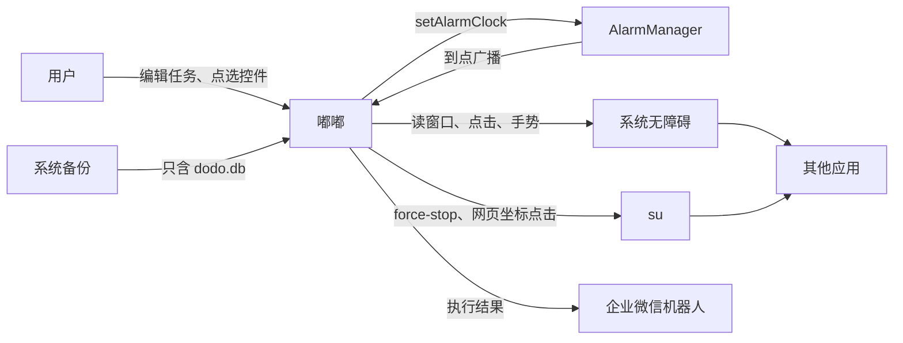
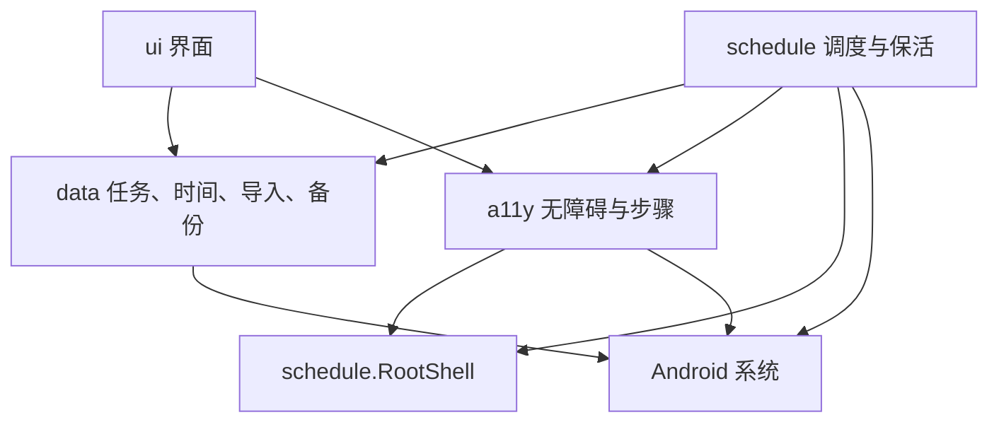
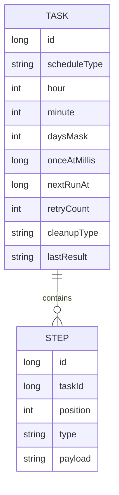
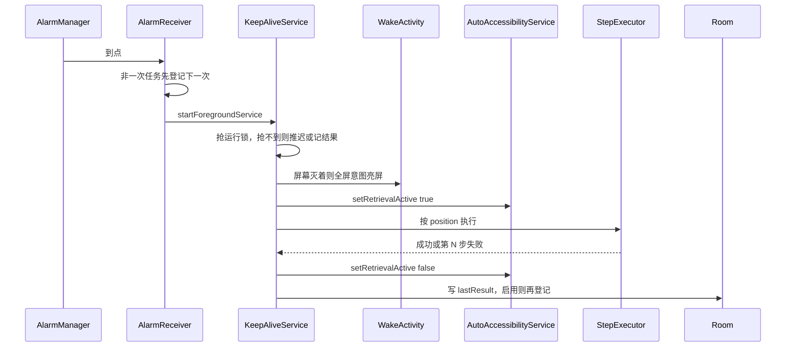
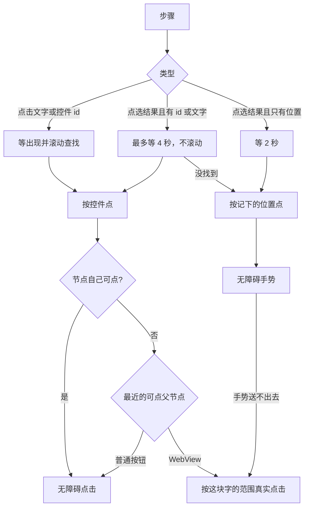

# 嘟嘟架构设计

本文描述当前工作区里的系统结构、运行链路和已经定下来的设计决定。操作步骤见 [开发者手册](开发者手册.md)，已经出过的故障见 [开发规范](开发规范.md)。

已发布版本是 1.0.3。点击策略在该版本之后又收紧过：普通按钮恢复无障碍点击，只有网页容器才按文字范围做真实点击。以本文和代码为准。

## 1. 目标与约束

嘟嘟把「一个时间 + 一组步骤」登记给系统，到点打开用户选定的应用并按步骤操作。它不是通用自动化平台，也不是无障碍读屏软件。

必须同时满足的约束：

| 约束 | 对架构的影响 |
| --- | --- |
| 目标机是已 root 的 MIUI 13 / Android 12 | 关应用走 `su`；系统会在强停进程时清掉无障碍服务 |
| 无障碍服务必须常开，否则到点无法点击 | Compose 会把本应用当成「有无障碍在听」，滑动时重排无障碍树 |
| 到点时进程可能已死、屏幕可能是灭的 | 闹钟、前台服务、亮屏页分开，不靠界面活着 |
| 同一次只跑一个任务 | 执行器是单飞的，第二个到来要推迟或记结果 |
| 步骤要能点原生按钮，也要点网页里的字 | 点击不能只有一种手段 |
| 用户编辑的是自己的任务，不是给别人分发的脚本 | 单机 Room，导入是追加 |

明确不做的事：

- 不把小米云服务的第三方数据备份说成已实现。系统备份只带走 `dodo.db`。
- 不在事件路径上忽略手机管家、设置等系统包。那会让每次无障碍事件都变重。
- 不用 `LazyColumn` 做本应用自己的短页面。选应用页是例外，因为整机应用带图标，放不进一层。

## 2. 上下文

嘟嘟不直接嵌入其他应用。它通过系统无障碍看窗口、通过 root 结束进程，通过闹钟把自己拉起来。

## 3. 逻辑分层

代码在一个 Android 应用里，按包分成五块。依赖方向只允许从上到下，调度可以调用无障碍，无障碍可以调用 root，界面和调度都只通过数据层读写任务。

| 包 | 职责 | 不负责 |
| --- | --- | --- |
| `ui` | 编辑任务、点选入口、滑动 | 不登记闹钟，不点其他应用 |
| `schedule` | 闹钟、亮屏、前台服务、开机恢复、企业微信、root 命令 | 不解析界面树 |
| `a11y` | 服务开关、读节点、点选、按步骤执行 | 不决定下一次什么时候跑 |
| `data` | Room、时间计算、JSON 导入导出、备份代理 | 不碰界面，不发手势 |
| `miui` | 这台 MIUI 的设置页入口 | 不查询那些开关是否真的打开。系统不提供查询 |

界面通过 `AutoAccessibilityService.instance` 发起点选。这是进程内的单例，不是绑定服务。服务没连上时，点选直接告诉用户去权限页打开。

## 4. 进程与界面栈

三个入口，三个职责：

| 组件 | 启动方式 | 任务栈 |
| --- | --- | --- |
| `MainActivity` | 桌面、通知。`singleTask` | 唯一主界面 |
| `WakeActivity` | 灭屏时的全屏意图。`singleInstance`，空 `taskAffinity` | 不进主栈，不进最近任务 |
| `KeepAliveService` | 有启用任务时的前台服务，`START_STICKY` | 无界面 |

闹钟和通知打开主界面时必须带 `FLAG_ACTIVITY_NEW_TASK | FLAG_ACTIVITY_CLEAR_TOP | FLAG_ACTIVITY_SINGLE_TOP`。否则每次到点都会再压一个主界面，编辑页会越来越卡。

`WakeActivity` 只负责把屏幕点亮，亮了就关。执行逻辑不放在它里面。

导航是单 Activity 的 `NavHost`：`list`、`edit?taskId=`、`picker`、`permissions`、`inspect`。新建任务的 `taskId` 为 0。

## 5. 数据

库文件 `dodo.db`，Room 版本 6，只做迁移，不做破坏性重建。

`steps.taskId` 外键级联删除。`payload` 是 JSON，类型白名单在 `StepTypes`。界面不建步骤表的列，避免每加一种步骤就迁移。

时间字段的分工：

- `hour` / `minute`：每天、每周是钟点。每小时存在 `hour`，每分钟存在 `minute`。
- `onceAtMillis`：只执行一次的绝对时间。
- `nextRunAt`：间隔任务已经算好的下一次。这是 v6 才有的锚点。

`nextRunAt` 只有在保存、重新启用、导入启用任务时才从「现在」重算。到点后续订和开机恢复都沿着旧锚点补间隔。否则「每 5 分钟」会在每次广播里被拨晚。

列表顺序是先启用、后按 id 倒序。导入不写 `lastRunAt`、`lastResult`、`nextRunAt`，启用的任务导入后按新锚点登记。

## 6. 到点执行

接收器使用 `goAsync()`，协程结束就取消作用域并 `pending.finish()`。不要挂一个活过广播的全局 scope。

执行锁是单飞的。一次任务如果碰上锁，把 `onceAtMillis` 推迟约 1 分钟再登记。其他类型只记下「已有任务正在执行」，不改间隔锚点。

失败后的顺序是：先按 `cleanupType` 做兜底，还有重试次数就从头再跑。次数用完后保留第一步失败的原因。清理自己的失败附在结果后面。一次任务只有闹钟触发且跑完才自动关闭；用户在界面上点「立即运行」不关闭。

结果最多留 300 字。填了企业微信地址就在写库之前发出去，发送失败的说明接在结果后面。

## 7. 无障碍的两种档位

服务配置文件里的空闲档是：只收 `TYPE_WINDOW_STATE_CHANGED`，标志只有 `FLAG_REPORT_VIEW_IDS`。`canRetrieveWindowContent` 和 `canPerformGestures` 保持打开，否则执行时来不及声明能力。

| 档位 | 何时 | 多出来的能力 |
| --- | --- | --- |
| 空闲 | 服务连上之后，执行结束，点选结束 | 无 |
| 检索 | `KeepAliveService` 跑步骤的那一段；点选遮罩显示期间 | 窗口内容变化、交互窗口、不重要节点 |

检索必须成对开关，失败路径也要关掉。空闲时一直开着检索，编辑页滑一会就会卡。点选时不打开检索，遮罩底下的窗口没有 view id。

`ignoredPackages()` 只决定哪个前台窗口可以记成「用户刚才看的应用」：桌面、输入法、嘟嘟自己、系统界面、`android`。手机管家和设置放在 `BlockedPickPackages`，只在点选那一刻拒绝，不进入事件路径。

节点用 `Session` 收集，包括为了点击而向上拿到的父节点，用完按身份去重后回收。

## 8. 点击

这是最容易改错的部分。三种步骤不要合成一种手段。

| 步骤 | 策略 | 原因 |
| --- | --- | --- |
| `CLICK_TEXT` / `CLICK_ID` | 查找大约 18 秒，找不到就滚动。点中用无障碍点击 | 「工作台」「上班拍照打卡」这类原生按钮靠父节点点击，以前就是这样生效的 |
| `CLICK_TARGET` 只有坐标 | 等 2 秒再点一次，不滚动 | 拍照页还没打开就点，会点在上一页上，还被记成成功 |
| `CLICK_TARGET` 有 id 或文字 | 最多等 4 秒，不滚动。找到按控件点，否则按坐标 | 确认按钮要等它出现。滚动会把拍照页滚走 |
| 父节点是 WebView | 不点整页。按文字自己的矩形做 `input tap` | 整页点击会返回成功，网页却没反应。WPS 签到是这种 |
| 文字范围是空的 | 仍点可点父节点 | 底部「我」的文字范围是 `[0,0][0,0]`，要点那个标签 |

坐标是相对 `displayMetrics` 宽高的比例，点选和回放用同一套度量，避免一个用全屏高度、一个用可用高度。

`CLICK_ID` 是旧数据，执行路径保留。新的点选一律写成 `CLICK_TARGET`，id、文字、描述、坐标都留下。

## 9. 点选

点选不在编辑页里完成。编辑页只负责记住「正在改哪一步」，然后回到目标应用。

1. `lastExternalPackage` 必须通过 `isPickTarget`。拦截名单挡住手机管家和设置，避免点选跳进系统页。
2. 打开检索，再回到目标应用。
3. 盖一层全屏透明遮罩，没有顶部取消条。取消条会挡住要点的控件。
4. 用户点一下后，先把遮罩从窗口上拿掉，再 `hitTest`。遮罩还在时，它是活动窗口，底下没有 id。
5. 底部结果卡确认后写入当前编辑的那一步；取消则清掉编辑下标。
6. 隐藏遮罩时关掉检索。

`hitTest` 跳过嘟嘟自己的节点，取包含该点的最小节点。

## 10. 界面滑动

本应用自己的页面用 `LayerScrollColumn`：内容按真实高度量一次，画进一个 `GraphicsLayer`，滑动只改 `translationY`，并用 `ViewParent.onDescendantInvalidated` 请求重画。布局位置不变，无障碍树就不会在每次滑动时重排。

图层必须包住内容的真实高度，裁剪放在外层。图层如果只有一屏高，画面能滑，点击仍落在滑动前的位置上。

使用这一层的页面：任务列表、任务编辑、权限、检查屏幕。选应用页继续用 `LazyColumn`，因为全部已安装应用都带图标。

编辑页的长按排序只在拖动和让缝时给步骤卡片加图层。平时不加，避免每一张卡片都变成独立合成层。输入框不准把页面追着光标滚，`NoChaseBringIntoView` 的滚动距离恒为 0。

## 11. 备份与发布

系统备份由 `DodoBackupAgent` 在全量备份前执行 `PRAGMA wal_checkpoint(FULL)`，规则只 include `dodo.db` 及其 wal、shm。`fullBackupOnly` 为 true。Android 12 上写了 include，就只会备份这些文件。

导入导出是另一条路：版本号为 1 的 JSON，最大 2_000_000 字节，追加任务，不替换本机数据。

发布由标签 `v*` 触发。工作流打 debug 包并挂到 GitHub Release。版本名和 `versionCode` 一起升。

## 12. 扩展时怎么加

| 要加的东西 | 放哪 | 不要做的事 |
| --- | --- | --- |
| 新的步骤类型 | `StepTypes`、`StepPayloads`、`StepExecutor.execute`、导入白名单、编辑页入口 | 不要给 `steps` 加列 |
| 新的时间类型 | `ScheduleCalculator`，并规定是否使用 `nextRunAt` | 不要在广播里重置间隔锚点 |
| 新的可滚动页面 | `LayerScrollColumn` | 不要为了省事用 `LazyColumn`，除非内容长到放不进一层 |
| 新的系统包要在点选时避开 | `BlockedPickPackages` | 不要放进 `ignoredPackages()` |
| 新的点击手段 | 先判定是原生按钮、网页，还是纯位置，再选一条已有路径 | 不要用面积阈值替换无障碍点击 |

## 13. 已知边界

- 同时只有一个任务在跑。第二个一次任务会推迟，不会排队成多任务调度器。
- 网页按钮没有稳定 view id 时，只能靠文字范围和坐标。网站改版后坐标会漂。
- 拍照页如果在 2 秒内还没打开，纯位置那一下仍会点空。这是故意不再滚动、也不连点的结果。
- 选应用页仍可能在快速滑动时顿一下。那是整机图标列表，不收进图层。
- 小米云服务不备份这份数据库。换机靠系统备份或 JSON 导出。
